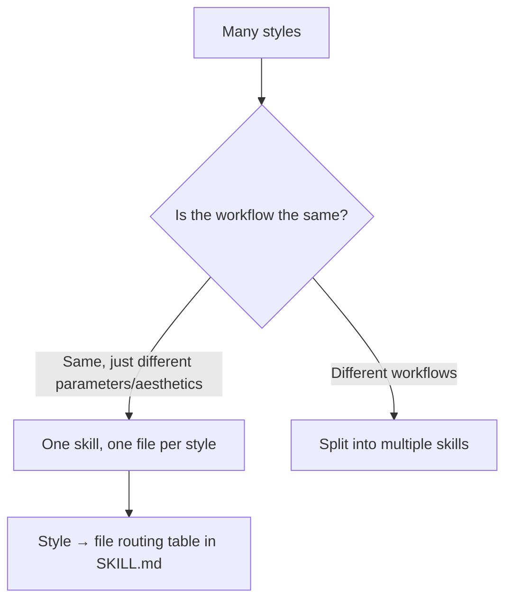
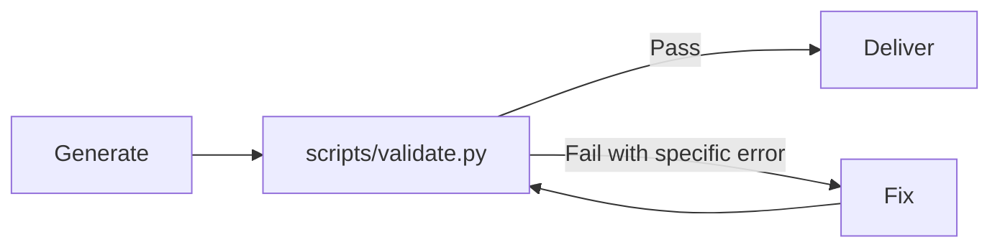

## TL;DR

**Treat Skills like software: start from real failures, include both documentation and tests; the documentation only explains what the model doesn't know; ensure format through validation scripts; after each task, review with real execution traces, turn each failure into a Gotcha and a test case; retest when switching models, retire if no detectable difference.**

## 1. My 7 Experiences

1. Don't pile up counterexamples; if one sentence can block it, write one sentence
2. Don't make Skills too large; for example, don't cram a dozen video styles into video production
3. If you need a standard format, provide a validation method instead of stacking prompts at the generation stage
4. Leave Claude some freedom; there will be surprises
5. Specify recommended information sources and how to search them
6. After each task, debrief with the lead Agent responsible for it
7. Skills should include: task sequencing, common problem solving, common misconceptions, reference materials, anti-pattern troubleshooting guide, test set

Additionally, a few more widely recognized precautions:

1. Trigger testing: the description determines whether a Skill gets used.
2. Baseline: retire it if results don't exceed the baseline.
3. Retest and retirement: after model capability improvements, is your Skill still useful?
4. pass^k: single success rate 75%, three consecutive successes only about 42%.
5. Security: watch for poison in third-party Skills.

## 2. Why

### 2.1 Counterexamples: One Rule Beats Ten Cases

Counterexamples naturally accumulate; every time you hit a pitfall you want to add one. The right approach is to compress regularly: find the common cause of this batch of counterexamples and write it as one rule.

**But distinguish by location:**

| Location | Should counterexamples be added | Reason |
|---|---|---|
| description (routing layer) | Yes, add "Don't use when" | Glean case study: after launching a Skill, trigger rate dropped ~20% in targeted evaluation; only recovered after adding counterexamples and edge cases |
| SKILL.md body (execution layer) | Compress into rules | Every line of the body consumes context |
| Gotchas section | Accumulate continuously but merge periodically | Thariq: Gotchas are the strongest signal in a Skill |

> Rule: **Gotchas can be long, but each item should be short; merge similar ones into one.**

### 2.2 Don't Make It All-in-One: Agents Won't Give You an A for Performance Just Because Your Skill Has More Pages

Take video production as an example: a dozen styles shouldn't be crammed into SKILL.md. How to split depends on **whether the workflow is the same**:



- References go only one level deep; put a table of contents at the top of long files.
- Reason: When Claude encounters nested references, it may only preview the first 100 lines, getting incomplete information.

### 2.3 Use Validation Instead of Constraints

Stacking prompt constraints at the generation stage wastes tokens and can't prevent occasional errors. A more reliable approach is to give the Skill a validation script, so the Agent runs a "generate → validate → fix by error" loop.



How to write a validation script:

- Design as a small CLI: runs from command line, deterministic output, clear failure on error.
- Errors must be specific: "Line 3 missing `price` field", not just "format error".
- The script handles exceptions itself, doesn't pass problems to the model; don't use unexplainable magic constants.
- In SKILL.md, specify whether it's "run" or "reference": `Run scripts/validate.py` vs `See scripts/validate.py`.

### 2.4 Leave Freedom, But Distinguish Open Ground From Narrow Bridges

Write goals and constraints, not every step. But freedom has limits: the more fragile and irreversible the operation, the lower the freedom.

| Freedom | Form | Scenario |
|---|---|---|
| High | Text describing goals and constraints | Creative work, review, solution design (surprises come from here) |
| Medium | Pseudocode, parameterized scripts | Preferred approach exists but variation allowed |
| Low | Fixed scripts | Database migration, financial calculations, operations with side effects |

> Output has validation as a safety net, so the process can be opened up.

### 2.5 Specify Recommended Information Sources and Search Methods

Specifying in the Skill "where to look and how to search" reduces wasted tokens on blind searching by Agents and improves accuracy. For details, see [Teaching Your Agent How to Research](https://rami0291.com/notes/let-your-agent-know-how-to-research/).


| What you need | Preferred source | Search method | Last verified |
|---|---|---|---|
| Amazon category rules | Seller Central help pages | site:sellercentral.amazon.co.jp + keywords | 2026-10 |
| Open source implementation references | GitHub, only recent projects with commits in the last 6 months | Sort by stars first, then check recent commits | 2026-10 |


> Environments like API calls may not have network access, so a fallback plan is needed.

### 2.6 Debrief: With Evidence, Not Feeling

The lead Agent has complete execution context, making it suitable for debriefing, but with one prerequisite: **the debrief input must be real execution traces and human judgment**. SkillsBench found that Skills written by models using only their own knowledge average no effect (−1.3pp), while human-curated Skills average a 16.2pp improvement.

Four debrief questions:

1. Which step got stuck, took a detour, or needed rework?
2. What content in the Skill was read, and what was never read?
3. Can this problem be solved with one rule or one script?
4. Turn this failure into a test case.

Four observation signals from Anthropic:


| Signal | Meaning | Action |
|---|---|---|
| Unexpected read order | Structure isn't intuitive | Reorganize the directory |
| Didn't follow key references | Links aren't prominent | Make references clearer and move them earlier |
| Read the same file repeatedly | It's core content | Move it into SKILL.md |
| A file never got read | Unused or guidance unclear | Delete it or rewrite the guidance |

**Anthropic also recommends an A/B pattern:** use one Claude (A) to help you improve the Skill, use another fresh instance (B) loaded with the Skill to run real tasks, then bring B's problems back to A. When the lead Agent debriefs, prevent "self-scoring"; important Skills can be given to a subagent who hasn't seen the execution for blind evaluation.

### 2.7 Complete Structure of a Skill

```
my-skill/
├── SKILL.md
│   ├── frontmatter: name + description  ← 入口：做什么 / 何时用 / 何时不用 / 用户会说的触发词
│   ├── 作业顺序 Workflow                ← 写目标与约束，不写每一步
│   ├── Gotchas 常见误区                 ← 每条一句，同类合并
│   └── 路由表 Routing table             ← 遇到什么症状 / 风格 → 读哪个文件
├── references/
│   ├── troubleshooting.md               ← 常见问题解决 + 反模式排查手册
│   ├── sources.md                       ← 推荐资料来源与检索方法
│   └── styles/*.md                      ← 按需加载的变体
├── scripts/
│   └── validate.py                      ← 输出检测
└── evals/
    ├── triggers.csv                     ← 触发测试 id,should_trigger,prompt
    ├── cases/                           ← 质量测试集（来自真实失败）
    └── README.md                        ← 基线结果 + 退役条件（出口）
```

The description and retirement conditions can be added as needed.

## Conclusion

Early on, I loved writing Gems (things similar to Skills in Gemini) to boost work efficiency, and I've since tried various ways of tweaking Skills. In the end, the Skills that fit best with my actual work are the most effective. Agents are companions that need high customization; generic always loses to tailored.
