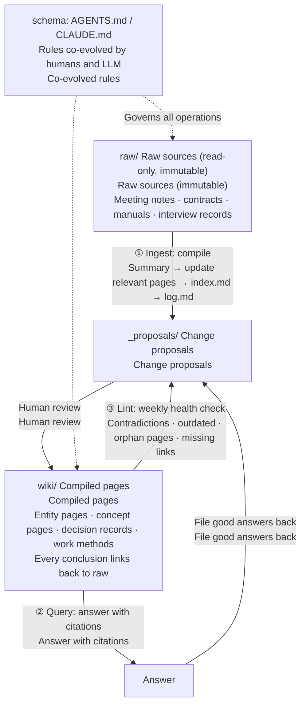

In April 2026, Andrej Karpathy published a gist under two thousand words proposing that LLMs maintain a Markdown wiki. Six months later, there are dozens of open-source implementations on GitHub, and Meta has built a similar system internally. For small and mid-sized businesses, the significance of this approach isn't that it's "another new tool"—it's that it makes "company knowledge bases" actually maintainable for the first time.

## TL;DR

1. The most popular RAG-based knowledge base may not suit your company—especially when your entries look too similar;
2. Even the best architecture needs maintenance. LLM-Wiki's advantage is you can build a genuinely usable knowledge base with minimal upfront cost, rather than sinking serious resources just getting started;
3. While cloud storage plus NotebookLM feels intuitive, it doesn't let Agents reuse that knowledge effectively.

## 1. Old Wine

Wiki was born in 1995 (Ward Cunningham's WikiWikiWeb), with a structure that's easy to understand: a collection of pages linking to each other. But most traditional wikis died for the same reason. Karpathy puts it this way: "Humans abandon wikis because the maintenance burden grows faster than the value."

Small and mid-sized companies face the same problem. There's rarely a shortage of people willing to share what they know—the hard part is that nobody can maintain the knowledge base itself. The runbooks old employees wrote as they left eventually go stale; cloud storage is full of forgotten docs that contradict each other. Even if you buy a ready-made knowledge base tool, employees crushed under business pressure don't have the bandwidth to maintain it.

## 2. New Bottle

So why does that old wine smell so good in a new bottle?

Karpathy's design has three layers:
- **Raw**: Read-only, the single source of truth.
- **Wiki**: Markdown pages generated and maintained by LLM.
- **Schema**: A rules file (like AGENTS.md, CLAUDE.md) that specifies structure and workflow, co-evolved by humans and LLM.

Three operations:
- **Ingest** (reading in new materials, one source might touch 10–15 pages);
- **Query** (read index, then relevant pages, answer with citations, good answers filed back into wiki);
- **Lint** (regular checks for contradictions, stale conclusions, orphan pages).

The fundamental difference from RAG is that curation happens at write time (ingest-time), not at query time (query-time). Knowledge therefore accumulates.

## 3. Why LLM-Wiki

### 3.1 NotebookLM: Knowledge Goes In, Doesn't Come Out

NotebookLM can ingest Drive files and web pages, and it does organization and Q&A well. But it's like a knowledge black hole: the insights it produces stay locked inside NotebookLM—you can only search and learn within it, and external Agents can't access or reuse them. It doesn't create portable assets. In the gist, Karpathy straight up puts NotebookLM in the "rediscover knowledge from scratch every time you ask" category. It's good for one-off intensive work—like reading twenty docs for a single project.

### 3.2 Cloud Storage + MCP: Slow, Messy

You can hook cloud storage to Agents via MCP, but search is neither comprehensive nor fast. The mechanism is the problem: cloud storage holds individual files with no organized directory or cross-references. Every time, Agents have to search, list files, open them one by one, re-read everything, make multiple round trips just to stitch together an answer—and do all that work over again next time.

### 3.3 RAG: Lost Big Picture

RAG returns only chunks similar to the query. The sources are all there, but cross-document associations and the broader context get lost. The only preregistered comparative study (arXiv 2605.18490) shows wiki is clearly better at cross-document synthesis, while RAG has a slight edge on single-fact lookup.

RAG has another issue that's common in practice: **semantic similarity doesn't mean it's the same thing**. Like product SKUs with similar model numbers, or "budget" and "resources" meaning different things across departments—vector search treats them as near-equivalent. Wiki can handle this with entity pages, disambiguation pages, and glossaries—assuming the schema requires pages to be named by model or ID. Otherwise the LLM might merge two distinct entities into one page during compilation.

### 3.4 GraphRAG: Overkill

GraphRAG handles multi-hop questions and global topics well, but it's expensive. In one evaluation, GraphRAG took 5,560 seconds to build the index; standard RAG took 135 seconds. Microsoft's LazyGraphRAG brings indexing costs down to RAG levels, but it's only deployed in Microsoft's own products—it never made it into open-source. For the knowledge volumes most small and mid-sized businesses have, the investment and maintenance burden far outweigh LLM-Wiki.

### 3.5 Comparison

| Dimension | LLM-Wiki | NotebookLM | Cloud Storage + MCP | RAG | GraphRAG |
|---|---|---|---|---|---|
| Setup | Minimal | Minimal | Zero | Medium–High | High |
| Cross-Document Synthesis | **Strong** | Strong (within notebook only) | Weak | Weak | Strong |
| Agent-Accessible | **Yes** | Difficult | Yes, but Slow | Yes | Yes |
| Accumulates | **Yes** | No | No | No | Partial |
| Portable | **Best** (Markdown + Git) | Poor | Fair | Fair | Poor |
| Permissions | Weak | Fair | **Strong** | Developable | Developable |
| Scale | ~100 sources / topics | 50–600 / notebook | Large | Large | Large but Expensive |

## 4. Is LLM-Wiki Perfect?

Clearly, LLM-Wiki has real boundaries.

### 4.1 Expensive Query Costs

Having Agents read large amounts of text significantly increases token consumption. Before answering, you read the index and multiple full pages; RAG reads only a few chunks. If you're paying per API call and all employees query frequently, that's a serious cost.

But many small and mid-sized companies use a **subscription model**. If one employee's monthly AI usage fits entirely within a \$20-level subscription, the extra tokens get absorbed by the subscription.

What matters more then is **usability**: Employees open a desktop Agent client, ask a question, and the Agent reads the wiki itself—way simpler than building a RAG system.

### 4.2 Knowledge Drift and Error Compounding

First, the more Agents edit, the more drift happens: LLM summaries look accurate but lose information. Second, models like Claude and GPT tend toward verbose defaults when unconstrained—entries get longer and longer.

The fix is straightforward: don't let Agents modify the raw sources, only cite facts precisely, or stricter: let Agents write proposals only, with humans deciding what gets merged.

### 4.3 Even the Best Architecture Needs Maintenance

LLM-Wiki just shifts human work from writing to reviewing. A software company's summary after running it for six months: "The upkeep doesn't disappear, it changes from writing pages to checking them." This is true for every approach: even if you just dump everything into cloud storage, someone has to decide what goes where, what gets deleted, and what version is current. An unreviewed wiki is actually dangerous because it looks neat and tidy—false information hidden in truth is hardest to spot.

### 4.4 Scale: Big Enterprises Still Need Mature SaaS

Karpathy's effective range is roughly 100 sources and a few hundred pages. Beyond that, the index won't fit in one read, and ingest can't determine which pages to update (Ranjan Kumar calls this the "Synthesis Horizon"). Once your organization or knowledge volume scales up, you need mature SaaS options like Confluence, Notion, or M365 Copilot—they handle permissions, search scale, and collaboration better.

### 4.5 Real-Time Data Belongs Where It Lives

Knowledge bases are for slow-moving judgments and rules. Whether RAG or wiki, they shouldn't carry real-time data. Inventory, pricing, order status—that data stays in your ERP, kintone, or database. Agents query it live via MCP or API. Lookup tables and dictionaries don't belong in the wiki either—don't compile them into prose.

## 5. Do Small and Mid-Sized Companies Need This?

### 5.1 The Problem Isn't the Tool

For many small and mid-sized non-tech companies, the first reason for not using AI is "we can't imagine where to use it" and "we lack the talent to push it forward."

A mature Agent should find its own work to do. If the wiki holds not just knowledge but work methods—how to handle quote requests, how to judge returns, how to generate reports—Agents can find the approach in the knowledge base, combine it with Claude or GPT's current desktop and web automation abilities, and get the job done. Employees don't have to figure out "where AI fits" first—they just say what they need done, and the Agent looks up how the company does it. "We can't imagine where this applies"—that problem shrinks.

Note: deciding what work warrants automation is still a business call. When Agents act on your desktop or web, steps involving placing orders, processing payments, or sending outbound messages should stay human-confirmed—especially if you haven't set hard boundaries for the Agent.

## 6. Last and Most Important

Have Agents interview your long-serving employees. The reason their knowledge is hard to extract is simple: they don't have time to write docs and don't know what should be documented. Have Agents conduct natural-language interviews and follow-ups instead—much lower barrier. Veterans just chat with the Agent.

A few approaches:
- **Ask about concrete cases, not abstract rules.** "How did you handle that return last time?" gets better answers than "What are the return rules?"
- **Store interview transcripts in raw/, then have the person review compiled pages before they're merged in.**
- **Use lint to find gaps.** Concepts without pages or conclusions without sources become your next interview checklist.

## 7. Conclusion

For small and mid-sized companies with limited knowledge volume, subscription-covered AI usage, and one person willing to review, LLM-Wiki is currently the most cost-effective knowledge base: near-zero setup cost, pure text you can take with you, Agents can read it directly, and knowledge gets richer with use. It's not a source archive—sources stay in cloud storage and SaaS tools. It doesn't handle real-time data either; that's what ERPs and databases are for. When your company scales to need fine-grained permissions and massive search volume, hand it off to a mature SaaS.