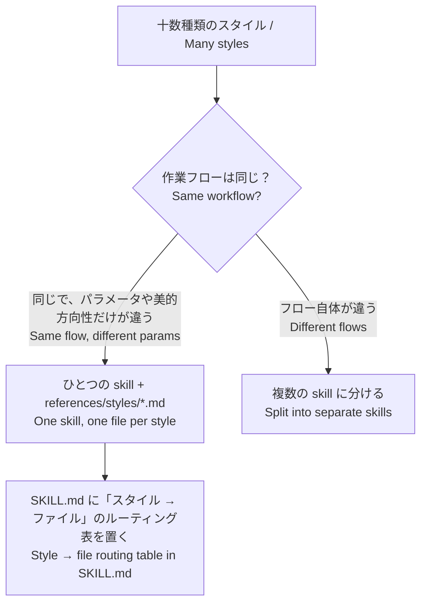
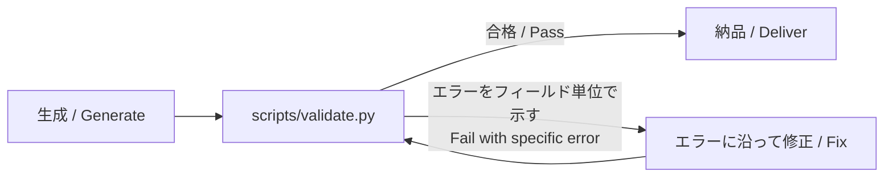

## TL;DR

**Skill はソフトウェアとして育てるべきだ**。実際の失敗を出発点に、本文とテストの両方を用意する。本文にはモデルが知らないことだけを書き、形式は検証スクリプトで保証する。タスクのたびに実際の実行記録を持ち寄って振り返り、失敗をひとつずつ Gotcha とテストケースに変える。モデルを替えたら再評価し、効果の差が出ない Skill は廃止する。

## 1. 私が学んだ 7 つのこと

1. 反例を際限なく積み上げない。一文で防げるなら一文にする。
2. Skill を大きくしすぎない。たとえば動画制作なら、十数種類のスタイルを全部詰め込まない。
3. 決まった形式が必要なら検証方法を用意する。生成時の prompt に制約を積み重ねない。
4. Claude に少し自由を残すと、うれしい驚きがある。
5. 推奨する情報源と検索方法を明記する。
6. タスクが終わるたびに、担当した Main Agent と一緒に振り返る。
7. Skill には、作業順序、よくある問題への対処、陥りやすい誤り、参考資料、アンチパターンの点検手引き、テストセットを含める。

加えて、一般に認められている注意点もいくつか挙げておく。

1. 発動テスト：Skill が使われるかどうかは description で決まる。
2. ベースライン：効果がベースラインを上回らなければ廃止すべきだ。
3. 再評価と引退：モデルの能力が上がっても、その Skill はまだ役に立つのか。
4. pass^k：1 回の成功率が 75% でも、3 回連続ですべて成功する確率は約 42% しかない。
5. セキュリティ：サードパーティー製 Skill に潜む「毒」に気をつける。

## 2. なぜそうするのか

### 2.1 反例：ひとつのルールは 10 個の事例に勝る

反例は自然に増えていく。失敗するたびに追加したくなるからだ。必要なのは定期的な圧縮で、複数の反例に共通する原因を見つけ、一文のルールにまとめることだ。

**ただし、書く場所によって扱いを分ける必要がある。**

| 場所 | 反例を追加すべきか | 理由 |
|---|---|---|
| description（ルーティング層） | 「使わない場面 / Don't use when」を追加する | Glean の事例では、Skill の公開後、対象を絞った評価で発動率が約 20% 低下し、反例と境界ケースを追加して初めて回復した |
| SKILL.md 本文（実行層） | ルールに圧縮する | 本文は一行ごとにコンテキストを消費する |
| Gotchas 節 | 蓄積しつつ、定期的に統合する | Thariq によれば、Gotchas は Skill の中で最も情報密度が高い部分だ |

> ルール：**Gotchas は長くなってもよいが、各項目は短く。同類はひとつにまとめる。**

### 2.2 大きく万能にしようとしない：ページ数が多くても Agent は高評価をくれない

動画制作を例にすると、十数種類のスタイルを SKILL.md に詰め込むべきではない。どう分けるかは、**作業フローが同じかどうか**で決める。



- 参照は 1 階層までにし、長いファイルの冒頭には目次を置く。
- 理由：Claude は参照が入れ子になっていると、最初の 100 行だけをプレビューして、情報を十分に読まないことがある。

### 2.3 制約の代わりに検証を使う

生成時の prompt に形式の制約を積み重ねても、token を使ううえに、時折起こるミスは防げない。より確実なのは、Skill に検証スクリプトを用意し、Agent に「生成 → 検証 → エラーに沿って修正」のループを回させることだ。



検証スクリプトの書き方は次のとおり。

- 小さな CLI として設計する。コマンドラインで実行でき、出力は決定的で、エラー時には明確に失敗するようにする。
- エラーは具体的にする。「3 行目に `price` フィールドがありません」と伝え、単なる「形式エラー」で済ませない。
- 例外はスクリプト自身で処理し、モデルに丸投げしない。説明のつかないマジックナンバーを使わない。
- SKILL.md では「実行」なのか「参照」なのかを明記する。`Run scripts/validate.py` と `See scripts/validate.py` は区別する。

### 2.4 自由を残す。ただし、広場と細い橋は区別する

目標と制約を書き、すべての手順は書かない。ただし、自由度には境界がある。操作が失敗しやすく、取り消しにくいほど、自由度を下げる。

| 自由度 | 形式 | 場面 |
|---|---|---|
| 高 | 文章で目標と制約を説明する | 創作、レビュー、設計案の検討。驚きはここから生まれる |
| 中 | 擬似コード、パラメータ付きスクリプト | 推奨する方法はあるが、変更も許容できる場合 |
| 低 | 固定されたスクリプト | データベース移行、財務計算、副作用のある操作 |

> 出力を検証で支えられるからこそ、過程を自由にできる。

### 2.5 推奨する情報源と検索方法を明記する

Skill に「どこで、どう調べるか」を書いておけば、Agent の闇雲な検索による token の浪費を減らし、正確性も高められる。具体的には[Agent に「まず調べる」ことを覚えさせよう](https://rami0291.com/ja/notes/let-your-agent-know-how-to-research/)を参照してほしい。

| 必要な情報 | 優先する情報源 | 検索方法 | 最終確認 |
|---|---|---|---|
| Amazon のカテゴリー規約 | Seller Central のヘルプページ | site:sellercentral.amazon.co.jp + キーワード | 2026-10 |
| OSS の実装例 | GitHub。直近 6 か月以内にコミットのあるプロジェクトに限る | まず stars 順に並べ、次に最新の commit を確認する | 2026-10 |

> API 経由の呼び出しなど、ネットワークを使えない環境もある。その場合の代替手段も用意しておく。

### 2.6 振り返り：感覚ではなく、証拠を持ち寄る

Main Agent は実行時のコンテキストを一通り持っているため、振り返りに向いている。ただし、**振り返りの入力は、実際の実行記録と人間の判断でなければならない**。SkillsBench では、モデルが自身の知識だけで書いた Skill は平均で効果がなく（−1.3 ポイント）、人間が企画・編集した Skill は平均で 16.2 ポイントの改善をもたらした。

振り返りで問うのは次の 4 点だ。

1. どの段階で止まり、遠回りし、やり直したか。
2. Skill のどの部分が読まれ、どの部分が一度も読まれなかったか。
3. この問題は、一文のルールか、ひとつのスクリプトで解決できるか。
4. 今回の失敗をテストケースにする。

Anthropic 公式が挙げる、観察すべき 4 つの兆候もある。

| 兆候 | 意味 | 対応 |
|---|---|---|
| 想定外の順序で読む | 構造が直感的でない | ディレクトリ構成を組み直す |
| 重要な参照先を読まない | リンクが目立たない | 参照の指示を明確にし、前のほうに置く |
| 同じファイルを繰り返し読む | それは中核となる内容だ | SKILL.md に移す |
| あるファイルが一度も読まれない | 不要か、案内が不明確 | 削除するか、案内を書き直す |

**公式は A/B 方式もすすめている。** ひとつの Claude（A）に Skill の改善を手伝ってもらい、その Skill を読み込んだ別の新しいインスタンス（B）で実際のタスクを実行する。そして B が遭遇した問題を A に持ち帰る。Main Agent が振り返る際は、「自分で自分に点をつける」ことを避けたい。重要な Skill なら、実行過程を見ていない subagent にブラインド評価を任せてもよい。

### 2.7 Skill の全体構成

```
my-skill/
├── SKILL.md
│   ├── frontmatter: name + description  ← 入口：何をするか / いつ使うか / いつ使わないか / ユーザーが使うトリガー語
│   ├── 作業順序 Workflow                ← 目標と制約を書き、すべての手順は書かない
│   ├── Gotchas 陥りやすい誤り           ← 各項目は一文にし、同類は統合する
│   └── ルーティング表 Routing table     ← 症状やスタイルに応じて読むファイルを示す
├── references/
│   ├── troubleshooting.md               ← よくある問題への対処 + アンチパターンの点検手引き
│   ├── sources.md                       ← 推奨する情報源と検索方法
│   └── styles/*.md                      ← 必要なときだけ読むバリエーション
├── scripts/
│   └── validate.py                      ← 出力の検証
└── evals/
    ├── triggers.csv                     ← 発動テスト id,should_trigger,prompt
    ├── cases/                           ← 品質テストセット（実際の失敗から作る）
    └── README.md                        ← ベースラインの結果 + 廃止条件（出口）
```

description と廃止条件は、必要に応じて補足すればよい。

## おわりに

以前の私は、Gem（Gemini にある Skill に似たもの）を書いて仕事を効率化するのが好きだった。その後も、Skill をあれこれ工夫する方法を試してきた。結局、最も役に立つのは、自分の目の前の仕事にぴったり合った Skill だった。Agent は、深くカスタマイズすることで頼れる相棒になる。汎用のものは、自分に合わせたものにはかなわない。
