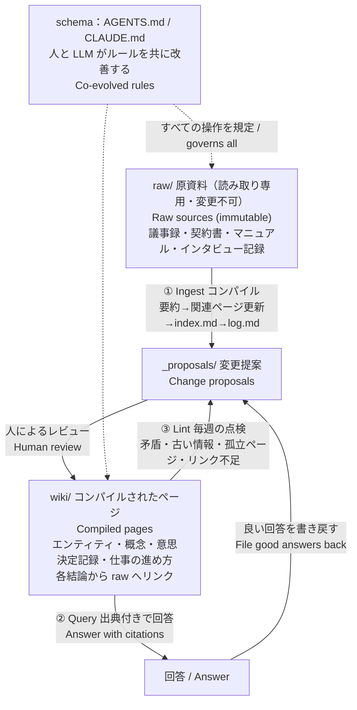

> 2026 年 4 月、Andrej Karpathy は 2,000 語にも満たない gist を公開し、LLM に Markdown の wiki を保守させる方法を提案した。半年がたち、GitHub にはすでに数十の OSS 実装があり、Meta も社内で同種のシステムを作っている。中小企業にとって、この考え方の意義は「また新しいツールが出た」ことではない。「会社のナレッジベース」を、初めて維持できるものにしたことにある。

## TL;DR

1. 最も注目されている RAG 型のナレッジベースが、自社に合うとは限らない。特に、項目同士がよく似ている場合はそうだ。
2. どれほど優れたアーキテクチャでも、保守する人は必要になる。LLM-Wiki の利点は、最初から大きな費用をかけず、最小限のコストで本当に使えるナレッジベースを作れることだ。
3. クラウドストレージ + NotebookLM という構成はわかりやすいが、その知識を Agent に渡して再利用させるには向いていない。

## 1. 古い酒

Wiki が誕生したのは 1995 年、Ward Cunningham の WikiWikiWeb だった。構造はわかりやすい。互いにリンクしたページの集まりだ。だが従来の wiki は、多くが同じ理由で使われなくなる。Karpathy の言葉を訳すと、「保守の負担が価値よりも速く増えるため、人は wiki を放棄する」。

中小企業でも事情は同じだ。経験を共有したい人がいないわけではない。難しいのは、ナレッジベース自体の保守が回らないことだ。ベテラン社員が退職前に血のにじむ思いで書いた業務マニュアルも、いつかは古くなる。クラウドストレージには、互いに矛盾する大量の古い文書が眠っている。既製のナレッジベース製品を購入しても、日々の業務に追われる社員には、何時間もかけて保守する余裕がない。

## 2. 新しい瓶

では、wiki という古い酒は、新しい瓶に入れるとどうして魅力を取り戻すのか。

Karpathy の設計は 3 層に分かれている。

- **原資料（raw）**：読み取り専用で、唯一の正しい情報源（source of truth）となる。
- **wiki**：LLM が生成・保守する Markdown ページ。
- **schema**：構造とワークフローを定めるルールファイル（AGENTS.md、CLAUDE.md など）。人と LLM が一緒に改善する。

操作は 3 種類ある。

- **Ingest**：新しい資料を読み込む。ひとつの資料が 10〜15 ページに影響することもある。
- **Query**：index を読んでから関連ページを読み、出典付きで回答する。良い回答は wiki に書き戻す。
- **Lint**：矛盾、古くなった結論、孤立したページを定期的に点検する。

RAG との最も根本的な違いは、整理が質問時（query-time）ではなく、取り込み時（ingest-time）に行われることだ。それによって知識が蓄積されていく。

## 3. なぜ LLM-Wiki なのか

### 3.1 NotebookLM：知識が入るだけで出てこない

NotebookLM は Drive のファイルや Web ページを取り込めて、整理も質疑応答もよくできる。だが、知識のブラックホールのような面がある。整理した成果は NotebookLM の中で調べ、学ぶことしかできず、外部の Agent が読んで再利用するのは難しい。持ち出せる資産としても残りにくい。Karpathy は gist で NotebookLM を「質問のたびに知識をゼロから再発見する」方式に分類している。あるプロジェクトのために 20 本の資料を読む、といった単発の集中的な整理には向いている。

### 3.2 クラウドストレージ + MCP：遅く、整理されていない

クラウドストレージは MCP を通じて Agent に接続できるが、検索は網羅的ではなく、しかも遅い。理由は仕組みにある。そこにあるのは個々のファイルであり、整理された目次や相互参照ではない。Agent は毎回、検索し、ファイルを列挙し、ひとつずつ開いて読み直さなければならない。何度もツールを呼び出してようやく答えを組み立て、次の質問では同じ作業をやり直す。

### 3.3 RAG：知識の全体像が失われる

RAG が返すのは、質問と似た断片だけだ。原資料はすべて残っていても、文書間のつながりや全体像の一部は失われる。現時点で唯一の事前登録された比較実験（arXiv 2605.18490）では、文書をまたぐ情報の統合では wiki が明確に優れ、単一の事実を調べる場合は RAG がやや優れていた。

RAG には、業務でよく起こる別の問題もある。**意味が近いからといって、同じものとは限らない**。たとえば型番が似た商品の SKU や、部署ごとに意味が違う「予算」「リソース」でも、ベクトル検索は似た内容として扱ってしまう。wiki なら「エンティティのページ + 曖昧さ回避ページ + 用語集」で対処できる。ただし、schema で型番や ID をページ名にするよう定めておくことが前提だ。そうしなければ、LLM がコンパイル時に別々のエンティティをひとつのページにまとめてしまう可能性もある。

### 3.4 GraphRAG：蚊を撃つのに大砲を使う

GraphRAG は、複数の関係をたどる質問や全体的なテーマに強いが、コストが重い。ある評価では、GraphRAG のインデックス構築に 5,560 秒かかったのに対し、通常の RAG は 135 秒だった。Microsoft の LazyGraphRAG はインデックスのコストをベクトル RAG 並みに下げたが、使われているのは Microsoft 自社製品だけで、OSS ライブラリには入っていない。中小企業の知識量を考えると、導入・保守のコストはいずれも LLM-Wiki を大きく上回る。

### 3.5 比較表

| 観点 / Dimension | LLM-Wiki | NotebookLM | クラウドストレージ + MCP | RAG | GraphRAG |
|---|---|---|---|---|---|
| 構築 / Setup | 極めて低コスト | 極めて低コスト | ゼロ | 中〜高 | 高 |
| 文書横断の統合 / Synthesis | **強い** | 強い（notebook 内に限る） | 弱い | 弱い | 強い |
| 外部 Agent からの利用 / Agent-accessible | **可能** | 難しい | 可能だが遅い | 可能 | 可能 |
| 知識の蓄積 / Accumulates | **あり** | なし | なし | なし | 一部あり |
| 可搬性 / Portable | **最も高い**（Markdown + Git） | 低い | 中 | 中 | 低い |
| 権限管理 / Permissions | 弱い | 中 | **強い** | 開発可能 | 開発可能 |
| 規模 / Scale | テーマごとに原資料約 100 件 | notebook ごとに 50〜600 件 | 大規模 | 大規模 | 大規模だが高コスト |

## 4. LLM-Wiki は完璧なのか

もちろん、LLM-Wiki にも明確な限界がある。

### 4.1 高い問い合わせコスト

Agent に大量の文章を読ませれば、Token の消費は大幅に増える。回答の前に index と複数のページ全体を読む必要がある一方、RAG が読むのは数個の断片だけだ。API の従量課金で全社員が頻繁に質問すれば、かなりの出費になる。

ただし、多くの中小企業では、料金体系は**サブスクリプション**だ。社員 1 人の月間 AI 利用量を 20 ドル程度の契約で十分に賄えるなら、質問時に増える token の費用もその中に収まる。

その場合により大切なのは、**使いやすいかどうか**だ。社員はデスクトップの Agent クライアントを開いて質問するだけで、Agent が自分で wiki を読みにいく。RAG システムを一式構築するより、ずっと簡単だ。

### 4.2 知識のずれと、積み重なる誤り

まず、Agent が編集を重ねるほど、内容はずれやすくなる。LLM の要約は正確に見えても、実際には情報が失われている。さらに、Claude や GPT などのモデルは、制約がなければ「おしゃべり」になりがちで、項目がどんどん長くなる。

対処はシンプルだ。知識の原資料を Agent に変更させず、正確さが必要な事実は引用だけにする。さらに厳しくするなら、Agent には提案だけを書かせ、反映するかどうかは人間が判断する。

### 4.3 どんなに優れたアーキテクチャでも保守する人は必要

LLM-Wiki は、人間の仕事を「書く」から「確認する」へ変えるだけだ。あるソフトウェア企業は、半年運用したあと、こう総括している。「保守がなくなるわけではない。ページを書く仕事が、ページを確認する仕事に変わる」。これはどの方式でも同じだ。資料をすべてクラウドストレージへ入れるだけでも、どこに置き、何を消し、どの版を現行とするかを誰かが決める必要がある。誰も確認しない wiki は、むしろ危険だ。見た目が整っているため、正しい情報に混ざった誤りほど見つけにくい。

### 4.4 規模：大企業には、やはり成熟した SaaS が必要

Karpathy が示す有効な範囲は、原資料が約 100 件、ページ数が数百程度だ。それを超えると index を一度に読み切れず、取り込み時にもどのページを直すべきか判断できなくなる。Ranjan Kumar はこれを「Synthesis Horizon」と呼んでいる。企業や知識の規模がある程度を超えたら、Confluence、Notion、M365 Copilot のような成熟した SaaS 型のナレッジベースが依然として必要になる。権限管理、検索規模、複数人での共同作業において、こちらのほうが成熟している。

### 4.5 リアルタイムデータは、適切な場所に置く

ナレッジベースは、一般に「変化の遅い判断やルール」を保存する場所だ。RAG でも wiki でも、リアルタイムデータを背負わせるべきではない。在庫、価格、注文状況といったデータは ERP、kintone、データベースに置き、Agent が MCP/API 経由でその都度問い合わせる。対応表や辞書のような構造化データも、文章に変換して wiki に放り込まないほうがよい。

## 5. では、中小企業にこれは必要なのか

### 5.1 問題はツールではない

非テック業界の中小企業が AI を使わない主な理由は、「どの業務に使えるか想像できない」「推進する人材がいない」というものだ。

成熟した Agent なら、自分で仕事の進め方を探すべきだ。wiki に「知識」だけでなく「仕事の進め方」、たとえば、こうした見積もり依頼にどう返答するか、返品をどう判断するか、レポートをどう作るかまで入っていれば、Agent はナレッジベースから方法を見つけられる。そこに Claude や GPT が現在備えているデスクトップ操作・ブラウザー操作の能力を組み合わせれば、そのまま仕事を実行できる。社員は先に「AI を何に使えるか」を考え抜く必要がない。やりたい仕事を伝えれば、Agent が会社でのやり方を調べる。「どの業務に使えるか想像できない」という難題を、これで一部解消できる。

ただし、「何を AI に任せる価値があるか」を決めるのは、依然として経営判断だ。Agent にデスクトップや Web を操作させるときは、発注、支払い、外部への送信に関わる手順に人間の確認を残すべきだ。特に、Agent に強制力のある境界を設けていない場合はそうだ。

## 6. 最後に、最も大切なこと

Agent にベテラン社員をインタビューさせよう。ベテランの頭の中にある知識を引き出しにくい大きな理由は、本人に文書を書く時間がなく、何を書けばよいかもわからないことだ。

Agent が自然な言葉でインタビューし、掘り下げて質問すれば、ハードルは大きく下がる。ベテラン社員は Agent と話すだけでよい。いくつか方法を挙げる。

- **抽象的なルールではなく、具体的な事例を聞く。**「返品のルールは何ですか」より、「この前の返品は、どう判断しましたか」のほうが実際の知恵を引き出しやすい。
- **インタビューの原文は raw/ に保存する。** コンパイルしたページは、本人に確認してもらってから反映する。
- **lint で抜けを探す。** wiki の中でページのない概念、出典のない結論を、次のインタビューの質問リストにする。

## 7. まとめ

知識量が限られ、AI の利用量をサブスクリプションで賄え、レビューを引き受ける人が 1 人いる中小企業にとって、LLM-Wiki は現時点で最も費用対効果の高いナレッジベースの形だ。構築コストはほぼゼロで、プレーンテキストなので持ち出せて、デスクトップ Agent が直接読める。使うほど知識も増えていく。原資料の倉庫ではないので、原資料はクラウドストレージや SaaS に残す。リアルタイムデータも扱わず、それは ERP やデータベースに任せる。会社が大きくなり、細かな権限管理や大量の情報の検索が必要になったら、成熟した SaaS に任せるべきだ。
