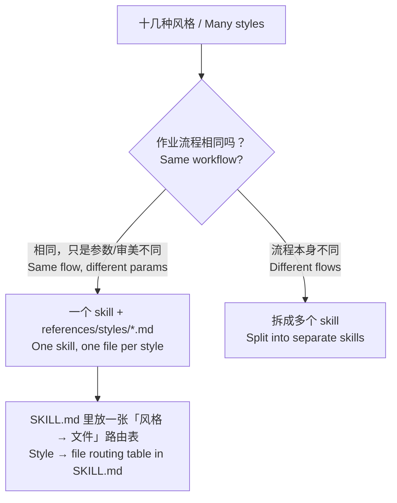
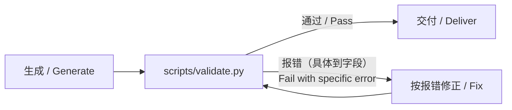

## TL;DR

**Skill 应该当成软件来养**：从真实失败出发，既要有正文，也要有测试；正文只写模型不知道的；格式靠检测脚本保证；每次任务后带着真实轨迹复盘，把每个失败变成一条 Gotcha 和一个测试用例；换模型就重测，测不出差别就淘汰。

## 1. 我的 7 条经验

1. 反例别越堆越多，一句话能挡住的就写一句话
2. Skill 别太大，比如视频制作别把十几种风格全塞进去
3. 需要标准格式就给检测方法，别在生成阶段堆 prompt
4. 给 Claude 留点自由度，会有惊喜
5. 写明推荐的资料来源和检索方法
6. 每次任务结束后和负责的主 Agent 一起复盘
7. Skill 应包含：作业顺序、常见问题解决、常见误区、参考资料、反模式排查手册、测试集

另外补充几条公认的注意事项：

1. 触发测试：description 决定 Skill 会不会被用上。
2. 基线：效果超不过基线就该淘汰。
3. 重测与退役：模型能力提升后，你的 Skill 是否还有用。
4. pass^k：单次成功率 75%，连续 3 次全成功只有约 42%。
5. 安全：小心第三方 Skill 里藏着“毒”。

## 2. 为什么

### 2.1 反例：一句规则胜过十个案例

反例会自然增长，每次踩坑都想加一个。正确做法是定期压缩：找出这批反例的共同原因，写成一句规则。

**不过要按位置区分：**

| 位置 | 反例该不该加 | 原因 |
|---|---|---|
| description（路由层） | 该加「何时不用 / Don't use when」 | Glean 的案例：上线 Skill 后触发率在定向评测中下降约 20%，加入反例和边界用例后才恢复 |
| SKILL.md 正文（执行层） | 压缩成规则 | 正文每一行都在消耗上下文 |
| Gotchas 节 | 持续积累，但定期合并 | Thariq：Gotchas 是 Skill 里信号最强的部分 |

> 规则：**Gotchas 可以长，但每条要短；同类合并成一条。**

### 2.2 别做大而全：Agent 不会因为你的 Skill 页数多就给你绩效打 A

以视频制作为例，十几种风格不该挤在 SKILL.md 里。怎么拆，看**流程是否相同**：



- 引用只放一层深，长文件开头放目录。
- 原因：Claude 遇到嵌套引用时可能只预览前 100 行，读到的信息不完整。

### 2.3 用检测代替约束

在生成阶段堆 prompt 约束格式，既费 token，又挡不住偶发错误。更可靠的做法是给 Skill 配一个检测脚本，让 Agent 跑「生成 → 检测 → 按报错修正」的循环。



检测脚本的写法：

- 设计成小型 CLI：命令行运行、输出确定、出错时明确失败。
- 报错要具体：「第 3 行缺少 `price` 字段」，不要只说「格式错误」。
- 脚本自己处理异常，不把问题甩给模型；不用无法解释的魔法常数。
- 在 SKILL.md 里写明是「执行」还是「参考」：`Run scripts/validate.py` vs `See scripts/validate.py`。

### 2.4 留自由度，但分清开阔地和窄桥

写目标和约束，不写每一步。但自由度有边界：操作越脆弱、越不可逆，自由度越低。

| 自由度 | 形式 | 场景 |
|---|---|---|
| 高 | 文字说明目标与约束 | 创意、审查、方案设计（惊喜来自这里） |
| 中 | 伪代码、带参数的脚本 | 有首选做法，但允许变化 |
| 低 | 固定脚本 | 数据库迁移、财务计算、有副作用的操作 |

> 输出有检测兜底，过程才敢放开。

### 2.5 写明推荐的资料来源与检索方法

在 Skill 里写明「去哪查、怎么查」，能减少 Agent 盲目搜索浪费的 token，也能提高准确性。具体可以参考[让你的 Agent 学会去搜索](https://rami0291.com/notes/let-your-agent-know-how-to-research/)。


| 需要什么 | 首选来源 | 检索方法 | 最近核对 |
|---|---|---|---|
| Amazon 类目规则 | Seller Central 帮助页 | site:sellercentral.amazon.co.jp + 关键词 | 2026-10 |
| 开源实现参考 | GitHub，只看近 6 个月有提交的项目 | 先按 stars 排序，再看最近 commit | 2026-10 |


> 通过 API 调用等环境可能没有网络，这时需要准备降级方案。

### 2.6 复盘：带着证据，而不是凭感觉

主 Agent 手里有完整的执行上下文，适合做复盘，但有一个前提：**复盘的输入必须是真实轨迹和人的判断**。SkillsBench 发现，模型只凭自身知识写的 Skill 平均没有效果（−1.3pp），而人工策划的 Skill 平均提升 16.2pp。

复盘四问：

1. 哪一步卡住、绕路或返工？
2. Skill 里哪些内容被读了、哪些从没被读？
3. 这个问题能用一句规则或一个脚本解决吗？
4. 把这次失败写成一个测试用例。

Anthropic 官方给出的四个观察信号：


| 信号 | 说明 | 动作 |
|---|---|---|
| 非预期的读取顺序 | 结构不直观 | 重组目录 |
| 没跟进关键引用 | 链接不显眼 | 把引用写得更明确、往前放 |
| 反复读同一个文件 | 它属于核心内容 | 移进 SKILL.md |
| 某文件从没被读 | 没用或指引不清 | 删掉或改写指引 |

**官方还推荐了一种 A/B 模式：** 用一个 Claude（A）帮你改 Skill，用另一个加载了 Skill 的新实例（B）跑真实任务，再把 B 遇到的问题带回给 A。主 Agent 复盘时要防止「自己给自己打分」，重要的 Skill 可以交给一个没看过执行过程的 subagent 盲评。

### 2.7 Skill 的完整结构

```
my-skill/
├── SKILL.md
│   ├── frontmatter: name + description  ← 入口：做什么 / 何时用 / 何时不用 / 用户会说的触发词
│   ├── 作业顺序 Workflow                ← 写目标与约束，不写每一步
│   ├── Gotchas 常见误区                 ← 每条一句，同类合并
│   └── 路由表 Routing table             ← 遇到什么症状 / 风格 → 读哪个文件
├── references/
│   ├── troubleshooting.md               ← 常见问题解决 + 反模式排查手册
│   ├── sources.md                       ← 推荐资料来源与检索方法
│   └── styles/*.md                      ← 按需加载的变体
├── scripts/
│   └── validate.py                      ← 输出检测
└── evals/
    ├── triggers.csv                     ← 触发测试 id,should_trigger,prompt
    ├── cases/                           ← 质量测试集（来自真实失败）
    └── README.md                        ← 基线结果 + 退役条件（出口）
```

description 和退役条件可以按需补充。

## 结语

早期我很喜欢写 Gem（Gemini 里类似 Skill 的东西）来提升工作效率，后来也试过各种折腾 Skill 的方法。到头来，还是最贴合自己手头工作的 Skill 最管用。Agent 是一个需要高度定制的好伙伴，通用的永远比不上定制的。
