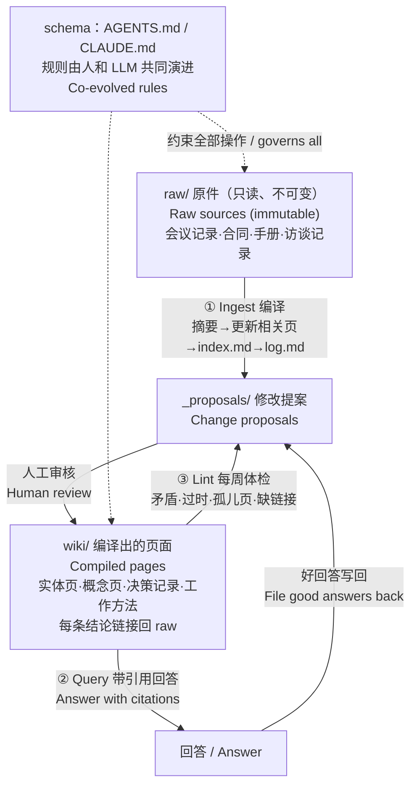

> 2026 年 4 月，Andrej Karpathy 发了一份不到两千词的 gist，提出让 LLM 来维护一套 Markdown wiki。半年过去，GitHub 上已有几十个开源实现，Meta 也在内部做了同类系统。对中小企业来说，这个思路的意义不在于"又一个新工具"，而在于它第一次让"公司知识库"这件事变得可以维护。

## TL;DR

1. 最热门的RAG架构知识库可能并不适合你的企业，特别是当你们的词条长得过于相似时；
2. 再好的架构也需要有人维护，LLM-Wiki的好处在于，你可以用最少的成本搭建一个真正可用的知识库，而不用在起步阶段就投入大量成本；
3. 网盘+NotebookLM的结构虽然直观，但没办法很好地把这些知识交给 Agent 复用。

## 1. 旧酒

Wiki 诞生于 1995 年（Ward Cunningham 的 WikiWikiWeb），结构很好理解：一堆互相链接的页面。但传统 wiki 大多死于同一个原因，Karpathy 的原话是："Humans abandon wikis because the maintenance burden grows faster than the value." 

中小企业的情况也是这样。公司里往往不缺愿意分享经验的人，难的是知识库本身维护不动：老员工离职前含着血泪写下的操作手册，总有一天会过时；网盘里还躺着无数尘封的旧文档，彼此观点相互矛盾。哪怕采购了现成的知识库产品，每天被业务压得喘不过气的员工，也没心思花几个小时去维护它。

## 2. 新瓶子

那么，wiki 这坛老酒，装进新瓶子怎么就香了呢？

Karpathy 的设计分三层：
- **原件（raw）**：只读，是唯一的事实来源（source of truth）。
- **wiki**：由 LLM 生成和维护的 Markdown 页面。
- **schema**：一份规则文件（如 AGENTS.md、CLAUDE.md），规定结构和工作流，人和 LLM 一起改。

三种操作：
- **Ingest**（读入新资料，一份资料可能牵动 10–15 个页面）；
- **Query**（读 index 再读相关页，带引用回答，好的回答写回 wiki）；
- **Lint**（定期查矛盾、过时结论、孤儿页）。

与 RAG 最根本的区别是：整理发生在写入时（ingest-time），而不是提问时（query-time）。知识因此会累积。

## 3. 为什么是LLM-Wiki

### 3.1 NotebookLM：知识只进不出

NotebookLM 能导入 Drive 文件和网页，整理、问答都做得不错，但它像一个知识黑洞：整理出来的成果只能在 NotebookLM 里面查、在里面学，很难被外部 Agent 读取和复用，也不会沉淀成可以带走的资产。Karpathy 在 gist 里直接把 NotebookLM 归为"每次提问都从零重新发现知识"的模式。它适合一次性的专项整理，比如为一个项目读二十份资料。

### 3.2 网盘 + MCP：慢，且乱

网盘可以通过 MCP 接给 Agent，但查找既不全面，还很慢。原因在机制上：网盘里存的是一份份文件，没有整理好的目录和交叉引用。Agent 每次都要搜索、列文件、逐个打开、自己再读一遍，来回调用很多次才能拼出答案，而且这些工作每次都要重做。

### 3.3 RAG：丢掉知识的全貌

RAG 只返回和问题相似的切片，原件虽然都在，但跨文档的关联和全貌会丢掉一部分。目前唯一的预注册对比实验（arXiv 2605.18490）显示：跨文档综合上 wiki 明显更好，单点事实查询上 RAG 略好。

RAG 还有一个在业务里很常见的毛病：**语义相近不等于同一个东西**。比如型号相近的商品 SKU，或者各部门口中含义不同的“预算”“资源”，向量检索却会把它们当成近似内容。wiki 可以用"实体页 + 消歧页 + 术语表"来处理，前提是 schema 里规定页面以型号或 ID 命名，否则 LLM 编译时也可能把两个实体合并成一页。

### 3.4 GraphRAG：大炮打蚊子

GraphRAG 擅长多跳问题和全局主题，但成本重。一项评估中，GraphRAG 建索引用了 5,560 秒，普通 RAG 只用 135 秒。微软的 LazyGraphRAG 把索引成本降到和向量 RAG 相当，但只用在微软自家产品里，没有进开源库。对中小企业的知识量来说，投入和维护成本都远超 LLM-Wiki。

### 3.5 对比表

| 维度 / Dimension | LLM-Wiki | NotebookLM | 网盘+MCP | RAG | GraphRAG |
|---|---|---|---|---|---|
| 搭建 / Setup | 极低 | 极低 | 零 | 中～高 | 高 |
| 跨文档综合 / Synthesis | **强** | 强（限 notebook 内）| 弱 | 弱 | 强 |
| 外部 Agent 可用 / Agent-accessible | **是** | 难 | 是，但慢 | 是 | 是 |
| 知识累积 / Accumulates | **是** | 否 | 否 | 否 | 部分 |
| 可移植 / Portable | **最好**（Markdown+Git）| 差 | 中 | 中 | 低 |
| 权限 / Permissions | 弱 | 中 | **强** | 可开发 | 可开发 |
| 规模 / Scale | ~100 份来源/主题 | 50–600 份/notebook | 大 | 大 | 大但贵 |

## 4. LLM-Wiki是完美的吗

显然，LLM-Wiki也有明显的边界。

### 4.1 昂贵的查询开销

任何让Agent读取大量文字的行为都会显著增加Token的消耗。回答前要读 index 和多个整页，而 RAG 只读几个切片。如果按 API 计费、全员高频查询，这可是很大的一笔开销。

但对很多中小企业，计费方式是**订阅制**。如果一个员工一个月的 AI 用量，用 20 美元级别的订阅就能完完全全覆盖，查询多花的 token 就被订阅吸收了。

这时更重要的是**好不好用**：员工直接打开桌面 Agent 客户端问问题，Agent 自己去读 wiki，比搭一套 RAG 系统简单得多。

### 4.2 知识漂移与错误复利

首先，Agent 编辑得越多，越容易漂移：LLM 的摘要看着准确，实则有损。其次，Claude 与 GPT 等模型在不加限制时偏向“话痨”，词条会越写越长。

解决方法也很简单，知识的原件不要让Agent修改，精确事实只能引用，或者更严格点，只允许Agent写提案，由人类判断是否合入。

### 4.3 再好的架构也要有人维护

LLM-Wiki 只是把人类的工作从"写"变成"审"。一家软件公司运行半年后的总结是："The upkeep doesn't disappear, it changes from writing pages to checking them." 这一点对所有方案都成立，哪怕只是把资料全部丢进网盘，也需要有人决定放哪、删哪、哪版是现行的。没人审的 wiki 反而危险，因为它看起来整整齐齐，真话里掺的假话最难被发现。

### 4.4 规模：大企业还是需要成熟的 SaaS

Karpathy 给出的有效区间是约 100 份来源、几百页内容。超过后，index 一次读不完，ingest 时也判断不了该改哪些页（Ranjan Kumar 称之为 "Synthesis Horizon"）。企业规模或知识量大到一定程度，仍然需要 Confluence、Notion、M365 Copilot 这类成熟的 SaaS 知识库方案，它们在权限、检索规模、多人协作上更成熟。

### 4.5 实时数据该去哪就去哪

知识库是存放"慢变的判断和规则"的通用做法，无论 RAG 还是 wiki，都不该承担实时数据。库存、价格、订单状态这类数据，留在 ERP、kintone 或数据库里，由 Agent 通过 MCP/API 现查。映射表、字典这类结构化数据，也不要编译成散文丢入wiki。

## 5. 那么中小企业需要这玩意吗

### 5.1 问题不在工具

很多非科技行业的中小企业，不用AI的第一理由就是“想象不出用在哪些业务”以及“缺少推动人才”。

一个成熟的Agent应该自己去寻找工作的办法。如果 wiki 里存的不只有"知识"，还有"工作方法"（这类询价怎么回、退货怎么判、报表怎么做），Agent 就能自己从知识库里找到做法，再配合 Claude、GPT 现在的桌面操作和网页操作能力，直接把事情做掉。员工不必先想清楚"AI 能用在哪"，只要说出要做的事，Agent 会去查公司是怎么做的。"想象不出用在哪些业务"这个难题，可以因此被解决一部分。

需要注意：决定"哪些事值得交给 AI"仍是经营判断；Agent 操作桌面和网页时，涉及下单、付款、对外发送的步骤应保留人工确认，特别是你们没有给Agent设置硬边界的时候。

## 6. 最后也是最重要的

让Agent去访谈你的老员工。老员工脑子里的知识难提取，很大原因是老员工没时间写文档，也不知道该写什么。

让 Agent 用自然语言访谈和追问，门槛低得多：老员工只需要和Agent聊天即可。几个做法：
- **问具体案例，不问抽象规则。**"上次那个退货你是怎么判的"比"退货规则是什么"更容易问出真东西。
- **访谈原文存进 raw/**，编译出的页面交给本人确认后再合入。
- **用 lint 找缺口。** wiki 里哪些概念没页面、哪些结论没出处，就成为下一次访谈的问题清单。

## 7. 总结

对知识量有限、订阅制就能覆盖 AI 用量、有一个人愿意负责审核的中小企业，LLM-Wiki 是目前最划算的知识库形态：搭建几乎零成本，纯文本带得走，桌面 Agent 能直接读，知识会越用越多。它不是原件仓库，原件留在网盘和 SaaS 里；它也不管实时数据，那是 ERP 和数据库的事。当企业大到需要精细权限和海量检索时，就该交给成熟的 SaaS 方案。